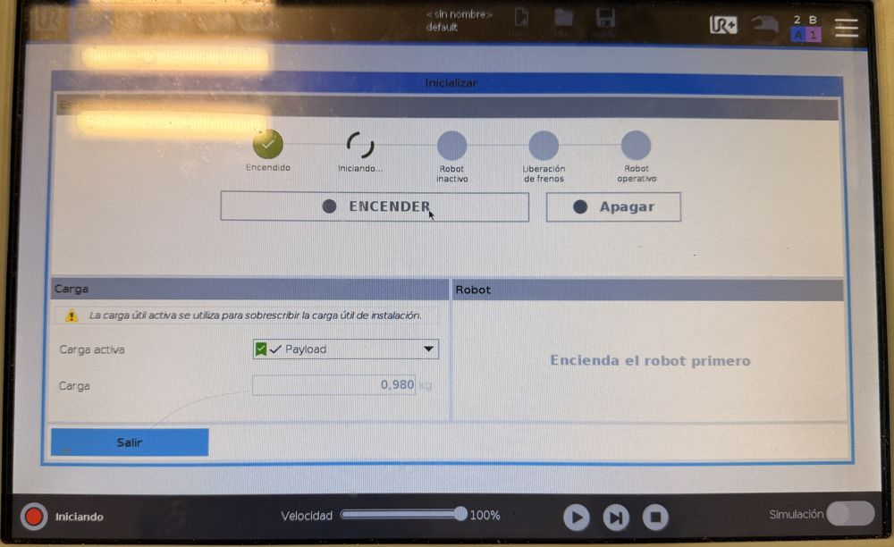
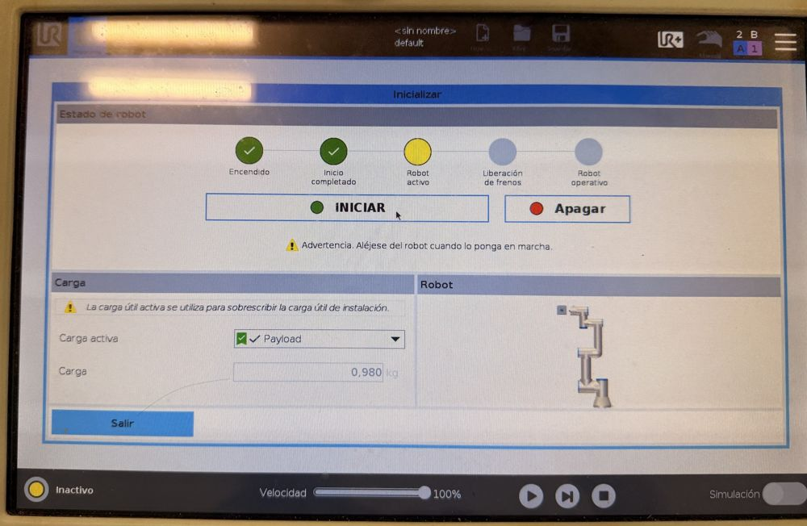
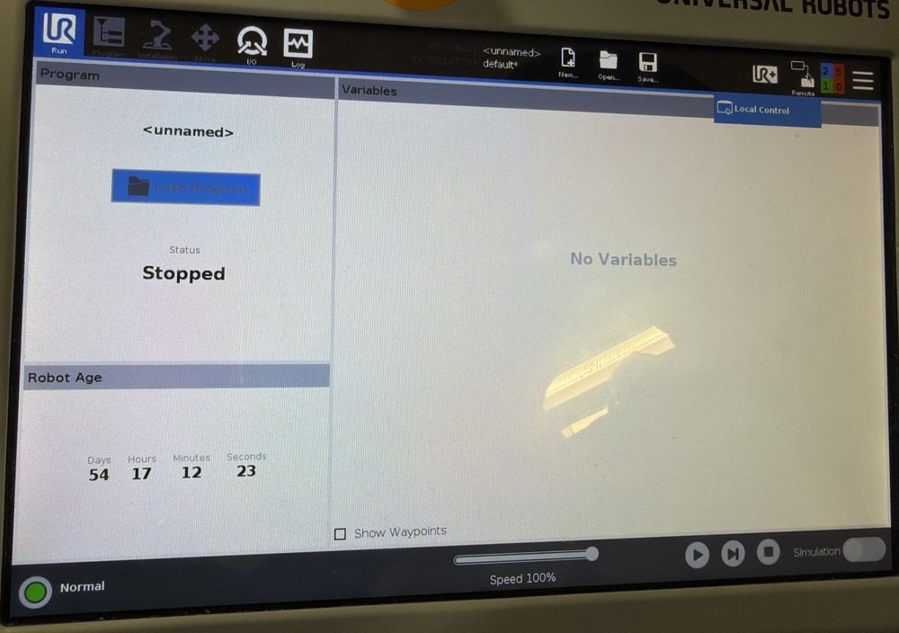
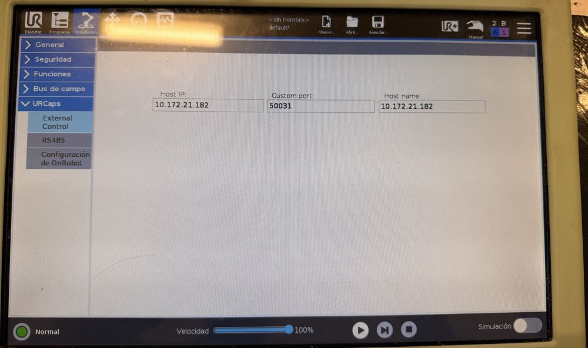
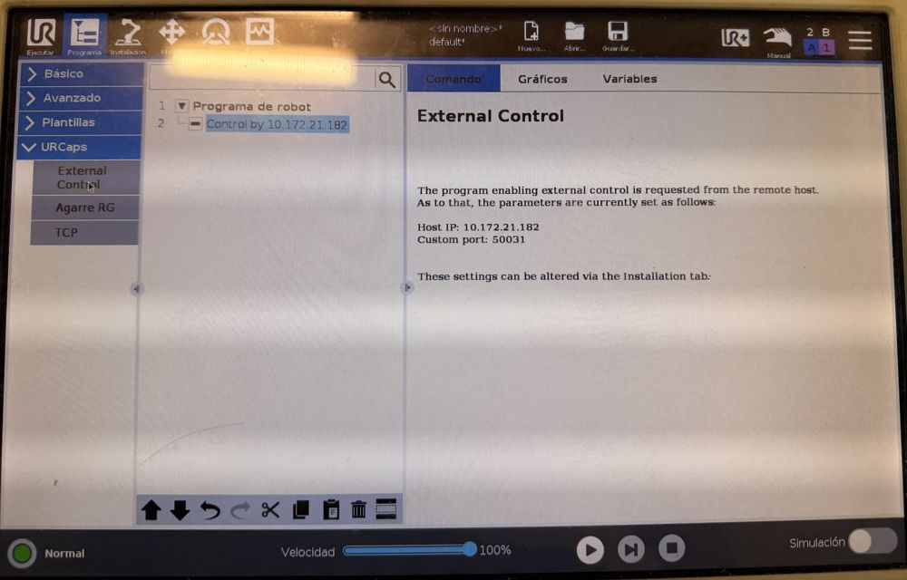
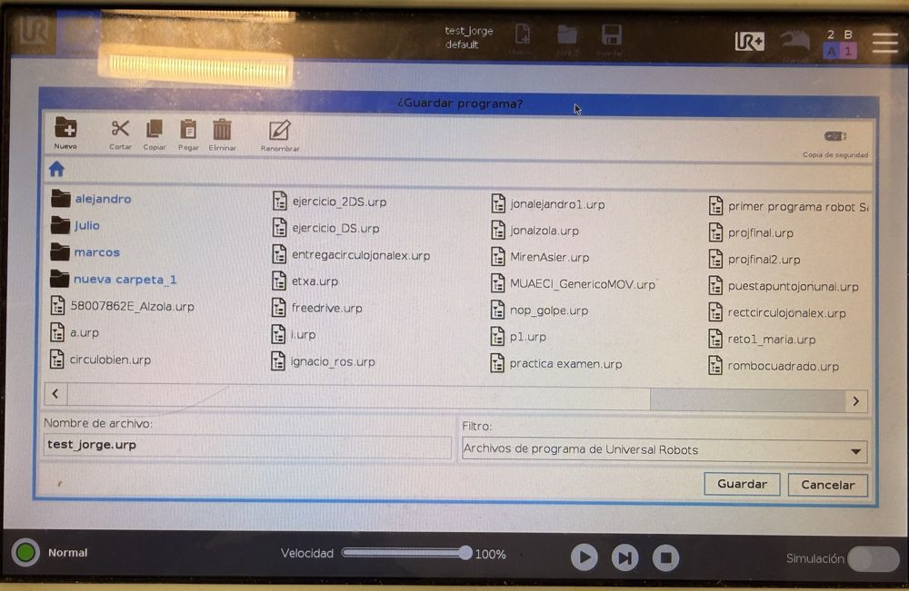
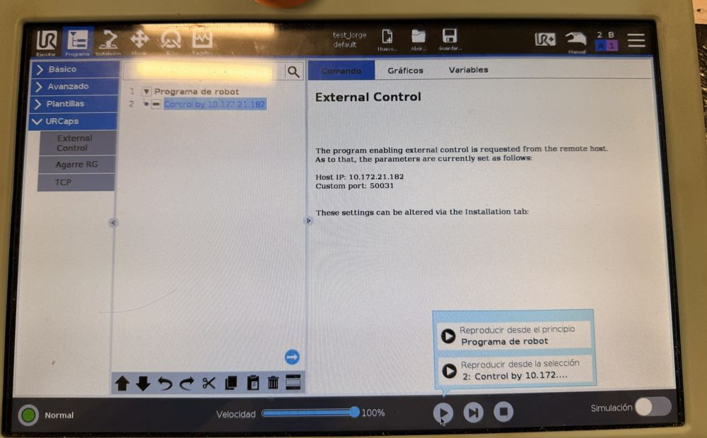

# javc-ur3e-lab-control-standalone

Controla los UR3e del laboratorio (simulados o reales) desde Windows con ROS 2 Jazzy y MoveIt 2.

- Imagen Docker propia (`Dockerfile`), sin depender de la imagen del curso
- Un solo contenedor: driver + MoveIt + RViz
- RViz se abre como ventana de Windows (WSLg) y usa la GPU

## Contenido

1. [Requisitos](#requisitos)
2. [Scripts](#scripts)
3. [Modo simulación](#modo-simulación)
4. [Modo real](#modo-real)
5. [Notas](#notas)

## Requisitos

- Windows 11 con WSLg (`ls /mnt/wslg` en WSL debe listar archivos)
- Docker Desktop abierto (*Engine running*) con integración WSL
- Terminal **WSL** en esta carpeta
- Archivo `.env` creado:

  ```bash
  cp .env.example .env
  ```

| Variable | Valores |
|---|---|
| `MODE` | `sim` · `robot` |
| `ROBOT_ID` | `203` · `204` · `205` · `206` (obligatoria) |
| `HOST_IP` | Tu IP del lab (obligatoria en `robot`) |
| `RVIZ` | `true` · `false` (abrir RViz) |

Para ver tu IP del lab, en **WSL** (en PowerShell sería `ipconfig | findstr 10.172.21`):

```bash
ipconfig.exe | grep -a 10.172.21
```

> [!IMPORTANT]
> Si cambias el `.env`, vuelve a correr `./start.sh` para aplicar los cambios.

---

## Scripts

- Van en `scripts/`
- Incluidos:
  - `go_home.py`: lleva el robot a la posición home
  - `stand_up.py`: pone el brazo vertical (stand up)
  - `gripper_open_close.py`: abre, cierra y vuelve a abrir la pinza
  - `pick_domino.py`: desde stand up, baja desde home, agarra una ficha de dominó acostada (por el ancho) y vuelve a stand up con ella
- Para correr uno (con `./start.sh` ya levantado):

  ```bash
  ./run.sh <script>.py
  ```

```python
from robot_controller import RobotController

robot = RobotController()
robot.current_joints()          # articulaciones actuales (rad)
robot.move_joints([...])        # mueve; devuelve True si lo logra
```

---

## Modo simulación

No necesita la red del laboratorio. El robot no se mueve.

1. En `.env`:

   ```bash
   MODE=sim
   ```

2. **WSL (terminal 1)**: levanta todo y espera `You can start planning now!`. La primera vez construye la imagen y compila el workspace (varios minutos)

   ```bash
   ./start.sh
   ```

3. **RViz** se abre solo como ventana de Windows

4. **WSL (terminal 2)**: el brazo va a home en RViz

   ```bash
   ./run.sh go_home.py
   ```

5. **Fin**:

   ```bash
   ./stop.sh
   ```

---

## Modo real

### Preparación del teach pendant (una sola vez por robot)

El teach pendant puede estar en español o en inglés; los nombres en inglés van entre paréntesis.

1. **Encender**: botón de estado abajo a la izquierda → **ENCENDER** (*ON*)

   

2. **Iniciar**: cuando *Robot activo* esté en amarillo → **INICIAR** (*START*), hasta tener los 5 ✓ → **Salir** (*Exit*)

   

3. **Modo de control**: arriba a la derecha, **Local**. Si no ves las pestañas *Programa* e *Instalación*, cambia también de *Automático* a **Manual** (puede pedir contraseña)

   

4. **External Control**: *Instalación → URCaps → External Control*
   - Host IP: tu `HOST_IP`
   - Custom port: `500X1` (203 → `50031` · 204 → `50041` · 205 → `50051` · 206 → `50061`)
   - Guarda la instalación: icono de disquete → *Guardar instalación*

   

5. **Programa**:
   - *Programa → Nuevo → Programa vacío*
   - Toca `<vacío>` → *URCaps* → **External Control** (debe quedar **un solo** nodo `Control by <HOST_IP>`)

   

6. **Guarda el programa**: icono de disquete → *Guardar programa como…* (por ejemplo `external_control`)

   


### Cada sesión

1. **Cable** a la red del laboratorio y comprueba tu IP en **WSL**:

   ```bash
   ipconfig.exe | grep -a 10.172.21
   ```

2. **`.env`**:

   ```bash
   MODE=robot
   ROBOT_ID=206
   HOST_IP=10.172.21.x
   ```

3. **Teach pendant**:
   - Enciende el robot (ENCENDER → INICIAR) y pon el modo **Local**
   - Baja el deslizador **Velocidad** (*Speed*) al 10–20 %
   - Carga el programa: *Abrir → Programa → external_control*
   - Si tu IP cambió, actualízala en *External Control*

4. **WSL (terminal 1)**: levanta todo y espera `You can start planning now!`

   ```bash
   ./start.sh
   ```

5. **Teach pendant**: ▶ → **Reproducir desde el principio** (*Play from beginning*). En la terminal 1 debe salir `Robot connected to reverse interface`

   

6. **WSL (terminal 2)**: con el área despejada y alguien en la seta de emergencia

   ```bash
   ./run.sh go_home.py
   ```

7. **Fin**: ⏹ en el teach pendant y luego:

   ```bash
   ./stop.sh
   ```

### Si algo falla

| Mensaje en el teach pendant | Solución |
|---|---|
| `connect_socket_with_retry is not initialized` | Puerto de *External Control* mal: debe ser `500X1` |
| `...external control end at 172.17.x.x...` | `HOST_IP` mal en el `.env`; corrígelo y vuelve a correr `./start.sh` |
| `... connected: False` con tu IP correcta | Abre el firewall de Windows (PowerShell como administrador, ver abajo) |
| El script se queda en `Waiting for MoveIt` | Corre `./start.sh` de nuevo y espera `You can start planning now!` |

Regla del firewall (solo si hace falta):

```powershell
New-NetFirewallRule -DisplayName "UR ROS" -Direction Inbound -Protocol TCP -LocalPort 50030-50062 -Action Allow
```

---

## Notas

- Los avisos `Overrun detected!` en el log son normales: Docker no da tiempo real
- Si cambias el `Dockerfile`, reconstruye la imagen:

  ```bash
  docker compose build
  ```

- Si cambias algo en `ros_workspace/src`, borra `ros_workspace/install` y vuelve a correr `./start.sh` para recompilar
- `ros_workspace/src` contiene los paquetes del laboratorio de Robótica del MUCSI (Universidad de Deusto), con dos ajustes: la URL del servidor de la pinza (`rg2_driver`) y el tamaño de la ventana de RViz
